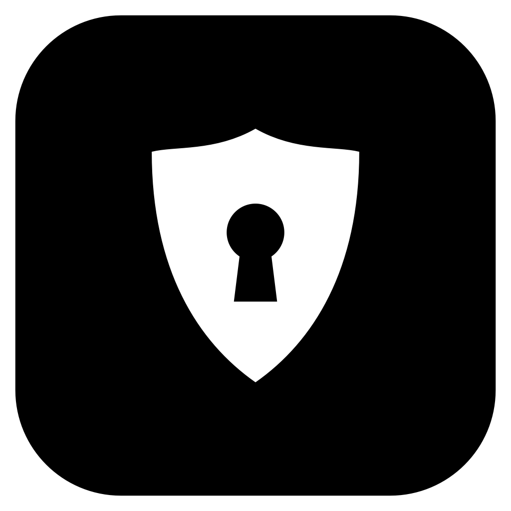

<div align="center">



# Aegis

**English** · [Русский](README.ru.md)

A local password manager for Windows. It lives in the tray, opens as a search
bar with `Ctrl + Shift + E`, and types your login into the window you called it
from. Nothing goes to the cloud.

</div>

## How to use

On first launch Aegis asks you to choose a master password — it encrypts the
whole vault. **It can't be recovered**, so remember it or write it down.

Press **`Ctrl + Shift + E`** in any app:

- **Entries for that window come first** — for the open site in a browser
  (`accounts.google.com` matches an entry for `google.com`), or by window
  title for desktop apps (the entry's “Window” field, e.g. `Steam`).
- **Enter** — Aegis goes back to that window and types the username, Tab, the
  password, Enter. It types keystrokes rather than pasting, and stops if you
  switch to another window.
- Opened from the tray (nowhere to type) — Enter copies the password.

| Shortcut | Action |
| --- | --- |
| `Enter` | auto-type the login / copy the password |
| `Ctrl + Shift + Enter` | auto-type the password only |
| `Ctrl + C` / `Ctrl + B` / `Ctrl + T` | copy password / username / 2FA code |
| `Ctrl + O` | open the website |
| `Ctrl + E` / `Ctrl + N` | edit / new entry |
| `Ctrl + K` | all actions |
| `Ctrl + L` | lock |
| `Ctrl + ,` | settings |

Copied passwords are cleared after 20 seconds and kept out of Windows
clipboard history (`Win + V`). Aegis locks itself after 15 idle minutes, on
`Win + L` and on sleep.

## Browser extension (optional)

Everything works without it. With it, sign-in fields get an Aegis icon: click
it, pick an entry, and the login is filled in. After you sign in with a new
password, Aegis offers to save it.

1. Aegis Settings → Browser Extension → **Open** (opens the extension folder).
2. In the browser: `chrome://extensions` → **Developer mode** → **Load
   unpacked** → choose that folder.
3. Click the Aegis toolbar icon → **Connect to Aegis** → **Allow** in Aegis.

The extension never gets your password list: only titles and usernames of the
entries matching the open site, and the password of the one entry you pick,
only for its own site.

## Where your data lives

| What | Where |
| --- | --- |
| Vault | `%APPDATA%\Aegis\vault.aegis` |
| Backups | `%APPDATA%\Aegis\backups\` |
| Settings | `%APPDATA%\Aegis\config.json` (no secrets) |

A backup is made after every change (edits within 10 minutes share one). Aegis
keeps the latest 20, plus one per day for a month and one per month for a year.
You can add a **second folder** — a cloud folder or a USB drive; backups are
encrypted like the vault itself.

## Importing passwords

Settings → Import & Export lists the browsers found on the computer. Vivaldi,
Opera, Chromium and Firefox are read directly. Chrome, Edge and Brave protect
passwords with App-Bound Encryption, so Aegis opens their export page instead:
confirm with your Windows PIN, and Aegis picks up the CSV from Downloads,
Documents or Desktop, imports it and deletes that one file — only a new `.csv`
with passwords inside that hasn't changed since it was read. Duplicates are
skipped. CSV files from Bitwarden, KeePass and 1Password import too.

## Security

The key is derived from the master password with **Argon2id** (64 MB per
attempt), the vault is encrypted with **AES-256-GCM**. While locked, neither
entries nor the key are in memory. No website icons are fetched.

## Building

```bash
pip install -r requirements.txt && python main.py
```

```bash
pip install -r requirements-dev.txt && python -m pytest
```

```bash
pip install pyinstaller pillow && python tools/make_assets.py && pyinstaller --clean --noconfirm Aegis.spec
```
