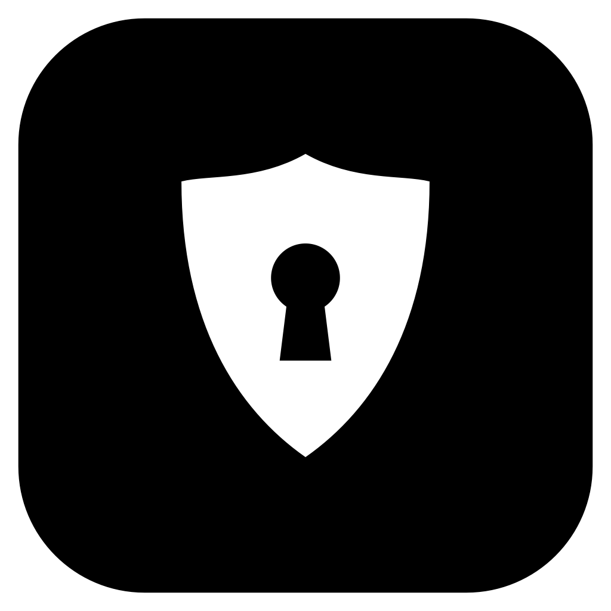

<div align="center">



# Aegis

[English](README.md) · **Русский**

Локальный менеджер паролей для Windows. Живёт в трее, открывается строкой
поиска по `Ctrl + Shift + E` и сам набирает логин и пароль в окно, из которого
его позвали. Ничего не уходит в облако.

</div>

## Как пользоваться

Aegis живёт в трее, рядом с часами. При первом запуске он предложит придумать
мастер-пароль — им зашифрована вся база. **Восстановить его нельзя**, запомните
или запишите.

Нажмите **`Ctrl + Shift + E`** в любой программе — появится строка:

- **Сверху — записи для этого окна.** В браузере — для открытого сайта
  (`accounts.google.com` подходит записи `google.com`), в программе — по
  заголовку окна (поле «Окно» в записи, например `Steam`).
- **Enter** — Aegis вернётся в то окно и наберёт логин, Tab, пароль, Enter.
  Набор идёт нажатиями клавиш, а не через буфер, и обрывается, если вы
  переключились в другое окно.
- Позвали из трея (набирать некуда) — Enter копирует пароль.

| Сочетание | Что делает |
| --- | --- |
| `Enter` | набрать логин и пароль / скопировать пароль |
| `Ctrl + Shift + Enter` | набрать только пароль |
| `Ctrl + C` | копировать пароль |
| `Ctrl + B` | копировать логин |
| `Ctrl + T` | копировать код 2FA |
| `Ctrl + O` | открыть сайт |
| `Ctrl + E` | изменить запись |
| `Ctrl + N` | новая запись |
| `Ctrl + K` | все действия |
| `Ctrl + L` | запереть |
| `Ctrl + ,` | настройки |

Скопированный пароль стирается из буфера через 20 секунд и не попадает в
журнал буфера Windows (`Win + V`).

Последовательность автонабора меняется в записи: `{USERNAME}`, `{PASSWORD}`,
`{TOTP}`, `{URL}`, `{TAB}`, `{ENTER}`, `{DELAY 300}` и обычный текст. Например,
для сайта, где логин и пароль на разных страницах:
`{USERNAME}{ENTER}{DELAY 1500}{PASSWORD}{ENTER}`.

Aegis запирается сам: через 15 минут простоя, при блокировке Windows
(`Win + L`) и уходе в сон. Всё это — в настройках.

## Расширение браузера (по желанию)

Без расширения всё работает через `Ctrl + Shift + E`. С ним в полях входа на
сайтах появляется значок Aegis: клик — список записей этого сайта, выбор —
логин и пароль подставлены. А после входа с новым паролем Aegis предложит его
сохранить.

1. Настройки Aegis → «Расширение браузера» → **Открыть** — откроется папка
   расширения.
2. В браузере: `chrome://extensions` (или `edge://extensions`) → включите
   **Режим разработчика** → **Загрузить распакованное** → выберите эту папку.
3. Нажмите значок Aegis на панели браузера → **Подключить к Aegis** → в окне
   Aegis нажмите **Разрешить**.

Работает в Chrome, Edge, Brave, Vivaldi, Яндекс Браузере и других браузерах на Chromium.

Расширение не получает список паролей: только названия и логины записей,
подходящих открытому сайту, а пароль — одной выбранной записи и только для её
сайта. Без подтверждения в Aegis оно не получает ничего.

## Где лежат данные

| Что | Где |
| --- | --- |
| База | `%APPDATA%\Aegis\vault.aegis` |
| Копии базы | `%APPDATA%\Aegis\backups\` |
| Настройки | `%APPDATA%\Aegis\config.json` (без секретов) |

**Копии** делаются сами после каждого изменения: правки подряд в течение 10
минут дают одну копию. Хранятся последние 20, плюс по одной за каждый день
месяца и за каждый месяц года. В настройках можно выбрать **вторую папку** —
облачную (Яндекс Диск, OneDrive) или флешку: копии зашифрованы так же, как
база, и без мастер-пароля бесполезны.

Восстановить копию — «Настройки → Копии базы → Восстановить». Текущая база
перед этим сама уходит в копии, так что восстановление можно отменить.

## Перенос паролей

**Из браузеров** — «Настройки → Импорт и экспорт», под кнопками CSV список
найденных браузеров:

- **Vivaldi, Opera, Chromium, Firefox** — «Импорт»: Aegis читает пароли
  напрямую, за пару секунд.
- **Chrome, Edge, Brave** — «Выгрузить…»: с 2024 года они шифруют пароли так,
  что расшифровать их может только сам браузер (App-Bound Encryption), и
  обходить эту защиту Aegis не станет. Откроется страница паролей браузера —
  нажмите «Экспорт паролей» и подтвердите PIN Windows. Aegis заметит файл в
  «Загрузках», «Документах» или на рабочем столе, импортирует и сотрёт его.
  Стирается только этот файл: появившийся после нажатия, `.csv`, с паролями
  внутри и не менявшийся с момента чтения. Остальное в папке не трогается.
- Firefox с основным паролем — тоже через выгрузку.

Повторы (тот же сайт, логин и пароль) не добавляются.

**Из другого менеджера** — «Импорт из CSV»: понимает выгрузки Bitwarden,
KeePass, 1Password и браузеров.

## Безопасность

- Ключ выводится из мастер-пароля **Argon2id** (64 МБ памяти на попытку —
  перебор на видеокартах дорог), база шифруется **AES-256-GCM**. Испорченный
  или подменённый файл не откроется, а не откроется молча с мусором.
- Пока база заперта, в памяти нет ни записей, ни ключа.
- Иконки сайтов не загружаются — иначе каждый сайт из базы узнал бы, что он
  в ней есть.
- Расширение говорит с Aegis через локальный канал, открытый только вашему
  пользователю Windows, и только после сопряжения.

Чего Aegis не защитит: от программы-шпиона, уже запущенной под вашей учётной
записью (она может читать нажатия клавиш и память процессов), — как и любой
другой менеджер паролей.

## Сборка

```bash
pip install -r requirements.txt
```

```bash
python main.py
```

Тесты:

```bash
pip install -r requirements-dev.txt && python -m pytest
```

Exe и установщик:

```bash
pip install pyinstaller pillow && python tools/make_assets.py && pyinstaller --clean --noconfirm Aegis.spec
```

Затем `aegis_setup.iss` в Inno Setup 6. Для автообновления в релиз на GitHub
кладётся zip с `Aegis.exe` — как у Spotty.
